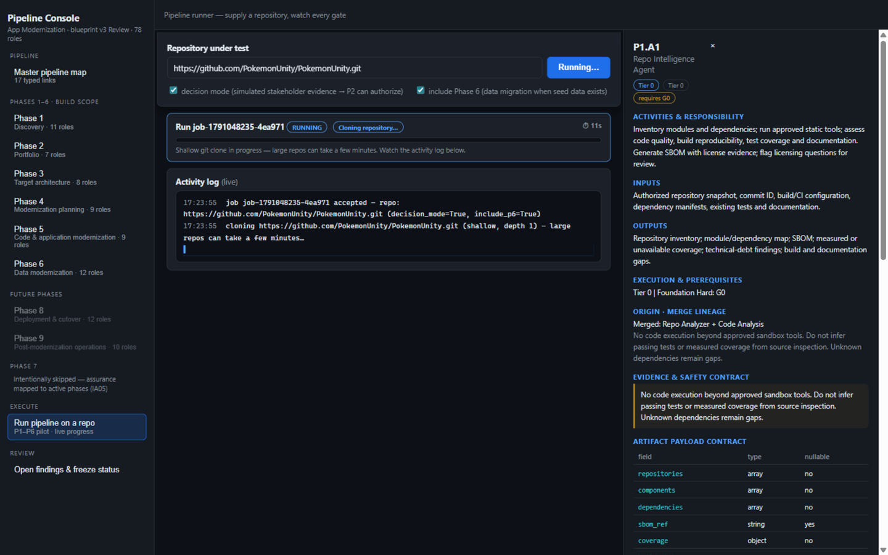
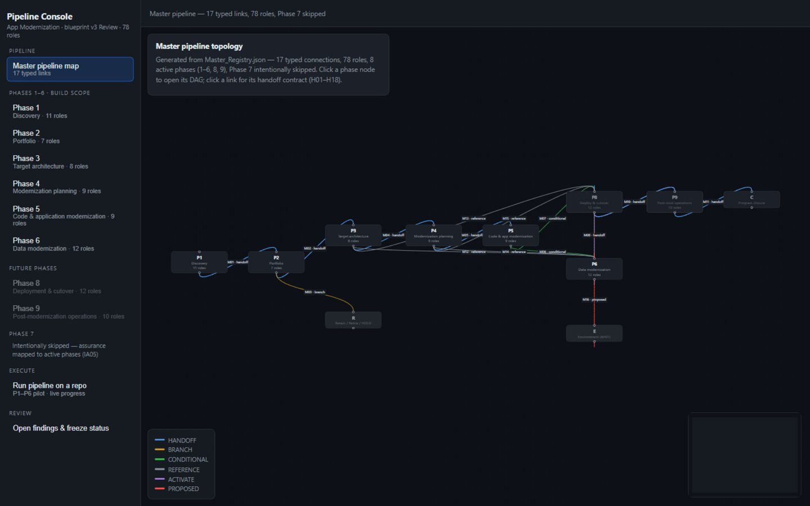
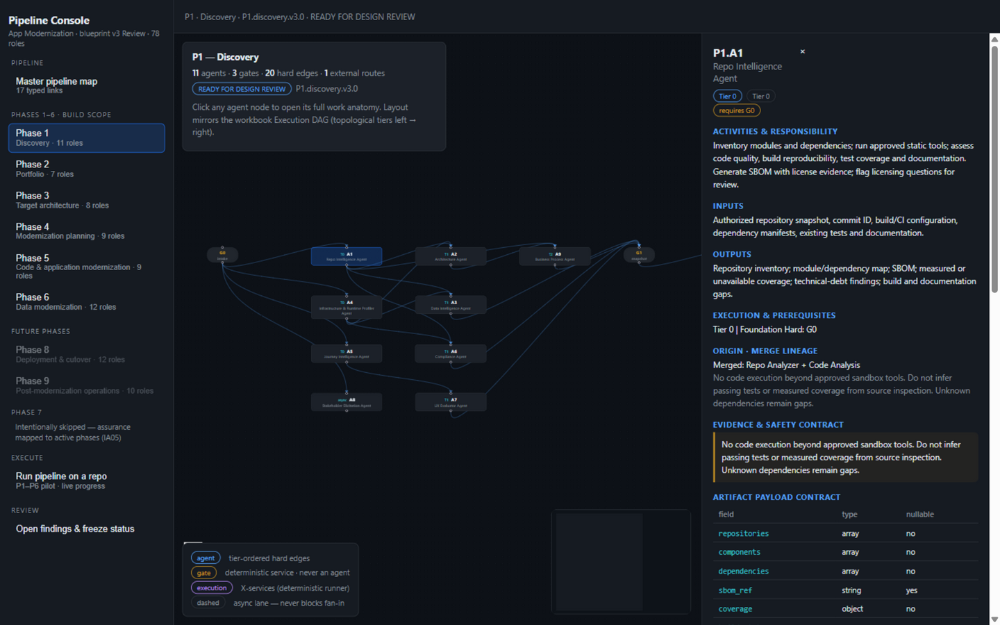
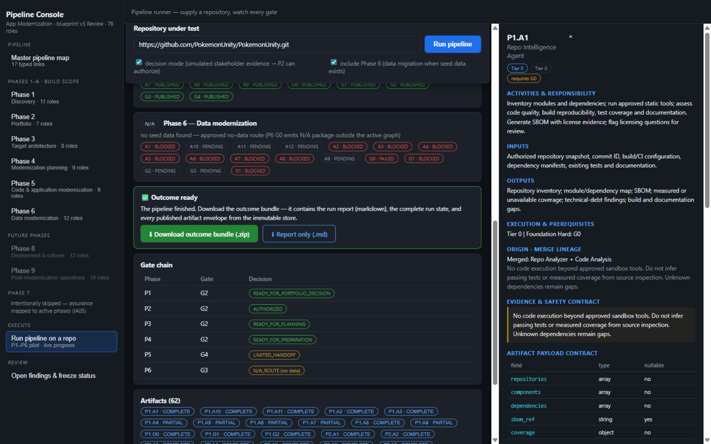

# New App Modernization

**An executable, agentic App Modernization pipeline** — compiled from a phase-by-phase
blueprint into a running product. Eight phase workbooks (78 agent roles, 190 hard
edges, 17 typed master links) become a Python kernel that orchestrates gated agent
DAGs through an immutable, content-addressed artifact store — with a React console
that shows the anatomy of every role and lets you **run the pipeline live on any
repository** (local path or git URL).

> **Pilot scope: Phases 1–6 are implemented and executable.** Phase 7 is intentionally
> skipped per blueprint finding IA05; Phases 8–9 (deploy/cutover, operations) are
> future scope. Every artifact carries honest evidence status — `NOT_RUN` never
> counts as `PASS`.

|  |
|:---:|
| **Pipeline runner** — paste a local path or a git URL; the console narrates the clone, every agent publication, and every gate decision live. |

## What it does

| Phase | Name | What runs | Release gate |
|---|---|---|---|
| **P1** | Discovery | 11 tool-backed roles: repo inventory (LOC/files/languages/deps), component & data analysis, capability route (UI / API_ONLY / HEADLESS), SBOM, snapshot seal | `READY_FOR_PORTFOLIO_DECISION` |
| **P2** | Portfolio decision | 8R disposition routing (Rehost/Replatform/Refactor/…) across the portfolio, wave planning, IA02 non-delivery register | `AUTHORIZED` |
| **P3** | Target architecture | Target stack map, NFR criteria, activation manifest | `READY_FOR_PLANNING` |
| **P4** | Planning | Five parallel planners (code/data/infra/test/ops) + cross-plan consistency | `READY_FOR_PREPARATION` |
| **P5** | Code & application modernization | Baseline oracle, change-manifest lanes, config/cross-cutting, integrated build manifest | `LIMITED_HANDOFF` (pilot depth — see conditions) |
| **P6** | Data modernization | Schema parity, **real batch migration** (X1 execution service: sqlite row-copy with reject journal + checkpoint), count/checksum reconciliation | `LIMITED_HANDOFF` / `N/A_ROUTE` |



## Quick start

**Requirements:** Python 3.12+ · Node 18+ · git (only for git-URL runs)

```bash
git clone https://github.com/ameyaraichur-lang/New-App-Modernization.git
cd New-App-Modernization

# 1. Backend
pip install -r requirements.txt

# 2. Frontend (the server serves the built bundle)
cd ui && npm install && npm run build && cd ..

# 3. Run
python -m appmod.server          # → http://localhost:8600
```

Then open **http://localhost:8600 → "Run pipeline on a repo"**, paste a repository
path or `https://github.com/org/repo.git`, and watch it execute.

**Options**

- **Decision mode** (default on) — simulated stakeholder evidence so Phase 2 can
  authorize an application. Every simulated record is labeled `simulated: true` /
  *PILOT SIMULATION* in its artifact; it is never treated as real owner approval.
- **Include Phase 6** (default on) — when the repo contains seed SQL, the runner
  builds real sqlite source/target fixtures and X1 migrates the rows. Without seed
  data, P6 emits an approved `N/A_ROUTE` package instead of failing silently.



## Agentic mode (Azure OpenAI "Astra")

With Astra configured, every P1–P4 agent (35 roles) runs a real tool-use loop on top of
its deterministic seed: it investigates the repository and upstream artifacts through a
sandboxed tool gateway, then submits a strict, evidence-cited outcome that the kernel
validates before publishing.

```bash
uv venv --python 3.12 && uv pip install -e ".[dev]"
cp .env.example .env               # APPMOD_ASTRA_ENDPOINT / APPMOD_ASTRA_API_KEY / deployments
uv run python scripts/install_tools.py   # scc, syft, osv-scanner, gitleaks (+ semgrep via uv tool)
uv run python scripts/doctor.py --live   # config, analyzers, tool catalog, MCP, one call per tier
uv run python -m appmod.server           # → http://localhost:8600 (sign in with a token)
```

- **Model tiers** — `reasoning` (gpt-6-astra), `coding`, `fast`, `fallback`, `embedding`;
  one automatic failover to the fallback tier on transient/unavailable errors; TPM limiter;
  record/replay response cache (`APPMOD_LLM_CACHE=off|read|record|replay`).
- **Tools** — repo (`read_file`, `grep`, `list_dir`, `search_code` embeddings, `git_log`, …),
  artifacts (`get_artifact`, `list_artifacts`), analyzers (`vulnerability_scan` osv,
  `secret_scan` gitleaks, `static_analysis` semgrep, `sbom_packages` syft, `loc_metrics` scc),
  portfolio (`app_similarity` code-embedding overlap), policy-gated `eol_lookup` (endoflife.date),
  plus any MCP server listed in `config/mcp_servers.json` (`mcp__<server>__<tool>`).
  Tool output is redacted, truncated and wrapped as untrusted evidence with a citable id
  (`ev-<sha>`, `art:<id>@v<n>`, `seed:<finding>`).
- **Agent loop** — deterministic seed → tool loop → strict `submit_outcome` → kernel checks →
  up to 2 repair rounds. Only the overlay's fields merge into the seed and status can only get
  stricter. If only citation problems remain, the kernel strips the bad ids; any other failure
  returns the seed with `llm.enriched = false` and a NOT_ASSESSED gap — never a silent success.
- **Evidence rules** (kernel-enforced) — uncited OBSERVED/DOCUMENTED → INFERRED; model-claimed
  HUMAN_CONFIRMED → HYPOTHETICAL; unknown citations stripped; COMPLETE with NOT_ASSESSED gap →
  PARTIAL; configured secrets redacted everywhere (artifacts, audit, events, logs).
- **Grounding** — cited paths must exist in the repository or be named by its code; P1.A9
  function names are matched against the source and unverifiable ones removed. Failures go back
  to the model as repair problems. Instruction-like text in tool output is recorded as an
  instruction-boundary incident on the envelope and does not change the agent's instructions.
- **Agent-specific reasoning** — P1.A11 scores risk per dimension from a policy rubric with
  evidence-matched anchors; P1.A9 locates processes with `search_code`; P2.A4 measures app
  overlap from embeddings; P2.A6 scores at least three of the 8R routes per app
  (`options_considered`) before choosing; P3.A1 grounds runtime targets in end-of-life data.
- **Portfolio runs** — several repos in one run: P1 per app (parallel) → one P2 portfolio
  decision → P3/P4 per authorized app. Single-repo runs continue to P5/P6.
- **Review modes** — `simulated` (gates auto-release, labelled) or `human`: P1–P4 release gates
  wait in `AWAITING_REVIEW` until a reviewer approves the exact candidate hash; P1.A8 confirmations
  come only from answers recorded in the questionnaire. Answers re-run only the affected nodes
  (reuse-by-input-hash); a changed candidate supersedes its pending review.
- **Durability** — jobs, events, reviews and questions live in `runs/appmod.db` (SQLite WAL).
  After a restart, interrupted jobs resume and reuse every finished node.
- **Auth** — bearer tokens with roles `viewer`, `operator`, `reviewer`, `stakeholder`, `admin`
  (`APPMOD_API_TOKENS="tok=user:role1,role2;…"`). With none configured, an admin token is
  generated into `runs/.admin_token` (mode 600). Repo-root and git-host allowlists and per-user
  run quotas apply to every submission.

**Acceptance run:** `uv run python scripts/e2e_agentic.py --label run1 --cache record` starts the
server, submits the corpus (`--repos …`, default 4 repos from `../corpus`) in human review mode
with live Astra, answers and approves through the API with a *scripted, labelled* reviewer and
stakeholder, and scores every P1–P4 agent dispatch (not FAILED + enriched by the live loop +
passes ContractValidator). P3/P4 slots for apps the authorized P2 gate routes to the
non-delivery register are reported as *not admitted*, alongside the all-slots rate.
`--rescore <job>` re-scores a finished job from the run DB. Reports land in `docs/runs/`.

**Release-gate eval (Step 33):** `uv run python scripts/eval_run.py --runs-dir runs --job <job>
--label <label>` scores a finished run: schema-valid after repair ≥ 95%, evidence
resolvability ≥ 90%, zero hallucinated paths and A9 symbols, agreement with the golden labels in
`evals/golden/corpus.json`, and variation of P2 dispositions and P3 boundaries across apps.

### Current results (live Astra, 10-repo corpus)

| Run | Measure | Result |
|---|---|---|
| [run4 e2e](docs/runs/e2e-run4.md) | P1–P4 agent dispatches passing | 270 / 270 (17 laravel58 P3/P4 slots not admitted: P2 routed it to Retain) |
| [run4 eval](docs/runs/eval-run4.md) | Step 33 release gate | PASS — schema 100%, evidence resolved 100% (14,988), 0 / 860 bad paths, 0 / 351 bad symbols |
| run4 eval | Golden-label agreement | language, framework, tests 100%; data layer 90% (todomvc's browser `localStorage` counted as data) |
| run4 eval | Variation | P2 Refactor ×5, Replatform ×4, Retain ×1; 9 distinct P3 boundary sets across 9 apps |
| [run3 e2e](docs/runs/e2e-run3.md) | P1–P4 agent dispatches passing | 287 / 287 |

What these numbers do **not** show: "success" means the artifact was produced by the live loop
and is schema-valid, not that a route or architecture is right. Resolvable citations prove the
evidence exists, not that it supports the claim. The reviewer and stakeholders were scripted,
golden labels cover four basic facts per repo, there is no runtime telemetry, P5–P6 remain
deterministic, and run-to-run stability is measured over two runs only. Expert-labelled routes
and boundaries are the next step for judging decision quality.

## The console

- **Master pipeline map** — all 8 active phases and the 17 typed links
  (HANDOFF / BRANCH / CONDITIONAL / REFERENCE / ACTIVATE / PROPOSED).
- **Phase DAGs** — each phase renders its topological execution graph; click any
  agent to open its **work anatomy**: activities & responsibility, inputs, outputs,
  execution prerequisites, merge lineage, evidence & safety contract, and the typed
  artifact payload contract.
- **Runner** — live per-node status chips, activity log, progress bar, gate-chain
  table, and a browsable artifact store (every envelope is one click away).
- **Findings & freeze status** — blueprint open findings (AH01–AH06) and the
  freeze recommendation per phase.



### Outcome bundle

When a run finishes you can download its outcome directly from the UI:

- `GET /api/runs/{job_id}/outcome` → **zip** (`REPORT.md` + `outcome.json` + every artifact envelope)
- `GET /api/runs/{job_id}/outcome?format=md` → report only

The report is generated **only from the run's immutable artifacts** — gate chain,
key facts, phase outcomes, the migration checkpoint table, reconciliation results,
and the honest-limits section. Nothing is invented; sections without evidence are omitted.

## Architecture

Five layers, one source of truth — the compiled blueprint registry drives both the
orchestrator and the UI:

```
blueprint workbooks (optional)  ─┐
                                 ├─▶ appmod/registry   XLSX→canonical JSON compiler + parity CI
shipped data/registry/*.json    ─┘                     (78 roles · 190 hard edges · 17 master links)
        │
        ▼
appmod/contracts    IA04 envelope + payload JSON Schemas, validators, payload normalizer
appmod/store        content-addressed immutable artifact store (lineage via parent_refs)
appmod/kernel       scheduler · generic gates · invalidation engine (AH06) · policy · audit · orchestrator
appmod/phases/p1–p6 phase engines (gate overrides + tool-backed agent runners)
appmod/server       FastAPI runner service + console API        ui/  React + React Flow console
```

Key mechanics, enforced by code (not convention):

- **Gates read transitive producers** (`ctx.published`), not just edge-connected inputs.
- **Immutable identity** — republishing the same artifact id+version with different
  content is rejected; new evidence creates a new revision.
- **Invalid publications are `FAILED`**, stored and blocking — never silently dropped.
- **Bounded retries** only for classified transient failures; exhausted work is `FAILED`.
- **Idempotency keys** — `phase/application/node/input-hash/policy-version`.
- **Registry parity CI** — the test suite re-verifies role/edge counts per phase and
  graph acyclicity (excluding EVENT edges) on every run.

## Conditions & honest limits

This is a **pilot at depth 1**: the full governance skeleton executes end-to-end,
with deliberate, recorded limits:

1. **Phase 5 authors change manifests, not applied code.** The runtime differential
   is therefore `NOT_RUN`, and G4 releases `LIMITED_HANDOFF` — never a full pass.
   (Depth 2: real patch application and builds.)
2. **Phase 6 batch migration is real** (X1 execution service, checkpoint, reject
   journal, count/checksum reconciliation), but service-flow validation is
   `NOT_RUN` without a running application → G3 `LIMITED_HANDOFF`.
3. **Simulated evidence is always labeled.** Reviewer identities and stakeholder
   responses produced in decision mode carry `simulated: true` and a PILOT
   SIMULATION basis. They let the *pipeline* exercise its authorization path; they
   never assert real human approval.
4. **`NOT_RUN` never counts as `PASS`.** Coverage/acceptance fields distinguish
   `COMPLETE` / `PARTIAL` / `NOT_ASSESSED` / `SKIPPED_APPROVED` / `FAILED`, with
   `evidence_class` (OBSERVED / DOCUMENTED / HUMAN_CONFIRMED / INFERRED / …).
5. **The blueprint workbooks are not included.** The pipeline runs from the shipped
   compiled registry (`data/registry/`, parity-checked on load). To recompile from
   your own workbook set, set `APPMOD_BLUEPRINT=<dir>` and run
   `python -m appmod.registry.compiler <blueprint_dir> <out_dir>`.
6. **Secrets are never written into artifacts**; the repo scanner records license
   evidence, not credential contents.
7. **No cloud/Docker dependencies** — everything runs locally on purpose (AH01:
   pre-provisioned local environments).
8. **Phase 8–9 are not implemented**; the UI shows them as future scope.

## Repository layout

```
appmod/
  registry/      blueprint compiler + parity verification (compile_all / load_registry / resolve_registry)
  contracts/     IA04 schemas, validators, normalize_payload
  store/         content-addressed artifact store
  kernel/        scheduler, gates, invalidation, policy, audit, orchestrator
  llm/           Astra Responses client, tier router + failover, TPM limiter, record/replay cache
  agents/        LLMAgentRunner tool loop, per-agent overlays, repo grounding checks
  tools/         repo scanner (repo_intel), tool gateway, analyzers, MCP client
  retrieval/     code embeddings for search_code and app similarity
  phases/p1..p6/ phase engines: gate overrides + agent runners
  server/        FastAPI app (api.py), jobs + run DB (jobs.py), outcome report (report.py)
ui/              React + React Flow console (views per phase, agent anatomy, runner)
data/registry/   shipped compiled registry (master.json, phase_*.json, pipeline_digest.json)
evals/golden/    labelled facts for the 10-repo corpus
scripts/         e2e_agentic.py · eval_run.py · doctor.py · astra_smoke.py · install_tools.py ·
                 p1_smoke.py · portfolio_run.py · e2e_pipeline.py
tests/           96 offline tests + 40 live Astra tests (tests/live, APPMOD_LIVE=1)
```

## Tests & scripts

```bash
uv run pytest -q                               # 96 offline tests (live ones skip)
APPMOD_LIVE=1 uv run pytest tests/live -q      # 40 live Astra tests: every tier, embeddings,
                                               # json_schema, strict submit_outcome per agent
uv run ruff check . && uv run mypy             # lint + types (also in CI)
python scripts/p1_smoke.py <repo-path>         # Phase 1 discovery on any repo
APPMOD_CORPUS=<dir> python scripts/portfolio_run.py   # P1×corpus + P2 portfolio routing
APPMOD_CORPUS=<dir> python scripts/e2e_pipeline.py    # full P1→P6 on spring-petclinic
```

The validation corpus (10 legacy repos: spring-petclinic, flask-tutorial,
django-realworld, express-realworld, musicstore, laravel58, sinatra, golang-example,
todomvc, react-redux-realworld) is **not shipped** — point `APPMOD_CORPUS` at a
directory of checkouts, or just run any repo through the UI.

## Console API

| Endpoint | Purpose |
|---|---|
| `POST /api/runs` | start a run `{repo \| repos[], review_mode?, llm?, decision_mode?, include_p6?}` (operator) |
| `GET /api/runs` / `GET /api/runs/{id}` | list / live snapshot (phases per app, gates, LLM usage) |
| `POST /api/runs/{id}/cancel` · `/resume` · `/rerun {phase, app, nodes}` | lifecycle (operator) |
| `GET /api/runs/{id}/events?after=` · `/stream?token=` | durable event log · SSE stream |
| `GET /api/runs/{id}/trace` | per-agent model calls, tool calls, rejected submissions |
| `GET /api/reviews?job_id=` · `POST /api/reviews/{id}/decision` | release-gate approvals (reviewer; 409 on stale hash) |
| `GET /api/runs/{id}/questions` · `POST /api/questions/{id}/answer` | stakeholder questionnaire (stakeholder) |
| `GET /api/runs/{id}/artifacts[/{artifact_id}]` | artifact pointers / one full envelope |
| `GET /api/runs/{id}/outcome[?format=md\|json]` | downloadable outcome bundle / report / state |
| `GET /api/health` · `/api/health/tools` · `/api/me` | liveness · Astra/analyzers/tools/MCP · identity |
| `GET /registry/{name}` | compiled registry JSONs |

## License

[MIT](LICENSE) — provided as-is, without warranty. Modernization decisions produced
by this pilot are decision *support*: simulated evidence is labeled as such, and no
artifact from this system should be treated as human approval.
